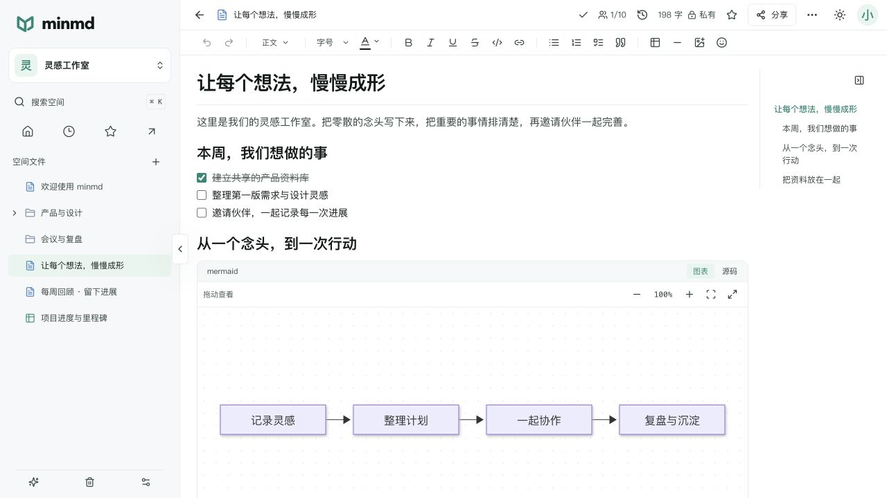
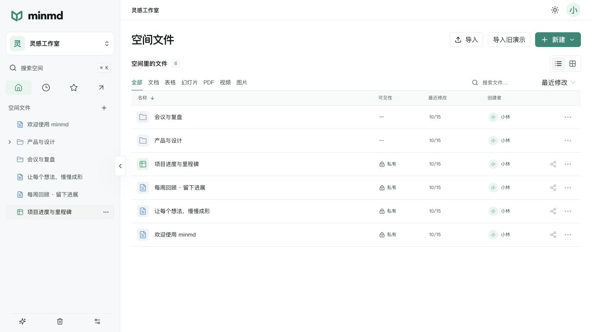
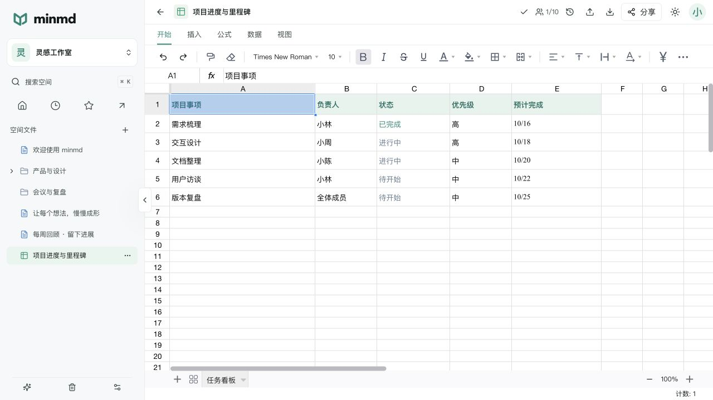
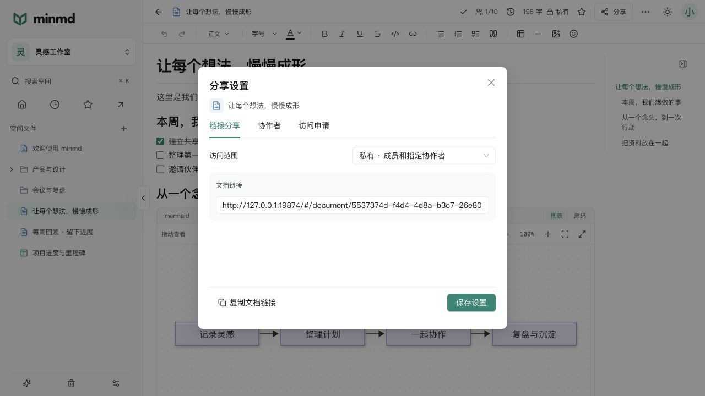

# minmd

**把文档、表格和资料，放进自己的空间。**

minmd 是一个开源、可自行部署的轻量文档协作系统。你可以用它写笔记、整理知识库、和伙伴一起编辑文档与表格，也可以上传 PPT、PDF、图片和视频，在浏览器中直接查看。

[在线演示](https://tingxi8087.github.io/minmd/) · [开始部署](#部署运行) · [上手使用](#怎么用) · [开发指南](docs/DEVELOPMENT.md) · [部署与维护](deploy/README.md)



[打开在线演示](https://tingxi8087.github.io/minmd/)：无需登录，可体验文档、表格和文件预览。演示不连接后端，修改与导入文件只保留在当前页面，刷新或重置后恢复示例；完整的协作、权限与版本功能需自行部署。

## 可以做什么

| 能力       | 用法                                                                              |
| ---------- | --------------------------------------------------------------------------------- |
| 文档编辑   | 标题、待办、正文表格、图片、代码高亮、表情与 Mermaid 图表；支持 Markdown 导入导出 |
| 在线表格   | 公式、多工作表、格式、筛选、排序和行列操作；支持 `.xlsx` 导入导出                 |
| 实时协作   | 文档和表格支持多人编辑、在线选区及个人撤销；每个文件默认最多 10 个编辑会话        |
| 文件空间   | 文件夹、搜索、拖拽移动、收藏和回收站，资料集中管理                                |
| 文件预览   | 上传 `.pptx`、PDF、图片和视频，直接预览并下载原文件                               |
| 分享与权限 | 默认私有，可指定协作者只读或编辑，也可生成公开链接；匿名访客始终只读              |
| 保存与版本 | 自动保存，支持手动保存及版本恢复；每个文件最多保留 100 个历史版本                 |
| AI 接入    | 通过空间密钥授权外部 AI，支持 MCP 和 HTTP API，可选择权限预设                     |

桌面和移动端均可访问，支持浅色、深色主题。适合个人资料整理、项目记录和小团队知识共享。

## 界面预览

**文件空间**：按文件夹和类型整理资料，快速搜索、收藏和分享。



**在线表格**：用熟悉的功能 Tab 管理数据、进度和计划。



<details>
<summary>查看分享设置</summary>

链接分享、指定协作者和访问申请分开管理。



</details>

截图使用独立演示环境中的虚构内容。

## 怎么用

1. **创建自己的空间**：首次打开网页时，按照引导创建前台账号、填写空间名称和选填描述。系统会创建默认空间，并放入一篇可自由编辑的入门文档。
2. **写下第一篇文档**：点击「新建」或侧栏「＋」。点击正文开始编辑，输入 `/` 插入标题、待办、表格、代码或图表。修改顶部标题也会更新文件名。
3. **上传已有资料**：使用统一上传入口，选中文件后自动识别类型。Markdown 和 Excel 转为可编辑内容；PPT、PDF、图片和视频用于预览与下载。
4. **整理与协作**：拖动文件到文件夹，使用搜索与收藏快速找到资料。在空间设置中管理成员，也可通过文件的「分享」按钮单独授权空间外的账号。
5. **控制访问范围**：新文件默认私有；公开链接可设为登录用户访问或所有人查看，并可配置密码和有效期。登录用户的链接权限可设为只读或编辑，未登录访客只能查看。无权限的登录用户可以申请访问。
6. **确认保存与恢复**：内容自动保存，顶部轻量图标显示保存状态。按 `Command / Ctrl + S` 立即保存；需要回溯时打开版本历史查看或恢复。

需要让外部 AI 帮忙整理内容时，在侧栏「AI 接入」创建空间密钥，再复制对应的 MCP 或 HTTP 接入配置。每把密钥单独设置权限，AI 不开放创建空间、成员管理和分享权限管理能力。

### 支持的上传类型

| 文件   | 支持格式             | 打开方式         |
| ------ | -------------------- | ---------------- |
| 文档   | `.md`、`.markdown`   | 导入后编辑       |
| 表格   | `.xlsx`              | 导入后编辑       |
| 幻灯片 | `.pptx`              | 只读预览、下载   |
| PDF    | `.pdf`               | 浏览器阅读、下载 |
| 图片   | PNG、JPEG、WebP、GIF | 缩放预览、下载   |
| 视频   | MP4、WebM            | 播放、下载       |

统一文件上传上限 **200 MiB / 文件**；文档内插图和头像上限 **1 MiB**。Excel 转换后的数据规模另有上限，高级图表、透视表和宏不转换；复杂 PPT 排版、字体和视频编码的兼容性取决于渲染库及浏览器。

## 部署运行

前台、管理后台、API、MCP 和协作连接都由**一个后端服务**提供，数据库使用 PostgreSQL。你只需要选择一种对外访问方式：

| 模式                 | 适用情况                         | 对外入口                                                             |
| -------------------- | -------------------------------- | -------------------------------------------------------------------- |
| 已有反向代理 `proxy` | 已有 Nginx、Caddy、1Panel 或宝塔 | 应用默认绑定 `127.0.0.1:9811`，由你配置 HTTPS 反代，不占用 80/443    |
| IP 直连 `direct`     | 没有域名，直接使用服务器 IP      | 默认监听 `0.0.0.0:9811`，使用 `http://服务器IP:9811`，无需反代或证书 |
| 自动 HTTPS `https`   | 有域名，希望自动配置证书         | 附带 Caddy，使用 TCP 80/443，应用和数据库端口不对外映射              |

### 1. 准备环境

- 安装 Docker 和 Docker Compose v2.20+；Windows 使用 WSL2。
- 选择 IP 直连时无需域名，在防火墙和云安全组放行应用 TCP 端口（默认 9811）。其他模式准备最终域名；自动 HTTPS 需要解析到服务器并开放 80/443，已有反代模式复用你的 HTTPS 入口。
- 准备 `tar`、`gzip`、`sha256sum`（macOS 可用 `shasum`）。一行安装需要 `curl` 或 `wget`；入口诊断需要 `curl`。

### 2. 选择安装方式

两种正式安装方式共用同一套向导，都可以选择 IP 直连、已有反代或自动 HTTPS。使用预构建镜像，服务器无需安装 Git、Bun、Node.js，也无需编译前端。

**方式一：一行命令安装**

国内镜像：

```sh
curl -fsSL https://github.com/tingxi8087/minmd/releases/latest/download/install-china.sh | sh
```

官方镜像：

```sh
curl -fsSL https://github.com/tingxi8087/minmd/releases/latest/download/install.sh | sh
```

没有 curl 时可以使用 wget：

```sh
wget -qO- https://github.com/tingxi8087/minmd/releases/latest/download/install.sh | sh
```

需要指定版本、目录或无人值守安装，见 [安装参数](deploy/README.md#方式一一行命令安装)。

**方式二：Release 部署包安装**

国内镜像源选择 `minmd-v版本-china.tar.gz` 和对应 `.sha256`；官方源选择无 `-china` 后缀的部署包。两套包的应用版本相同，安装配置分别绑定各自镜像源，不要混用校验文件。

在 [Releases](https://github.com/tingxi8087/minmd/releases) 下载同一版本的 `minmd-v版本.tar.gz` 和 `.sha256`。以下以 `v0.1.0` 为例，替换为实际发布版本：

```sh
sha256sum -c minmd-v0.1.0.tar.gz.sha256
# macOS：shasum -a 256 -c minmd-v0.1.0.tar.gz.sha256
tar xzf minmd-v0.1.0.tar.gz
cd minmd
./minmd.sh install
```

按提示选择模式、填写最终访问地址；IP 直连填写 `http://服务器IPv4:9811`，其他模式填写 HTTPS 地址。安装器检查端口与资源冲突，自动生成凭证、初始化数据库并启动服务。

上述下载地址由正式版本发布流程提供，需先发布包含安装资源的 Release 才可使用，版本号以实际 Releases 为准。尚无可用部署包或需要修改源码时，见 [源码构建部署](docs/DEVELOPMENT.md#源码构建部署)。

### 3. 配好入口，打开网页

IP 直连模式放行端口后，直接打开安装时填写的 HTTP 地址。已有反代模式将 HTTPS 域名反代到应用端口，并开启 WebSocket 和流式响应支持；自动 HTTPS 模式等待证书签发。填写的访问地址必须与浏览器地址一致。

IP 直连目前支持 IPv4，默认只开放应用端口，不使用 80/443；HTTP 不加密账号、内容和密钥的传输，适合内网或临时体验，公网长期使用建议选择 HTTPS。

```sh
./minmd.sh status
./minmd.sh doctor
```

打开配置的访问地址，完成前台初始化，即可使用。后台位于同一域名的 `/admin/`，初始后台账号密码由安装器输出；**后台管理员和前台账号相互独立**。

安装后进入部署目录 `minmd/` 执行维护命令。默认部署配置保存在该目录的 `.minmd/`，数据库、附件及证书保存在 Docker 数据卷。当前采用单 app 实例，协作房间在进程内管理。

端口调整、反代示例、配置说明和故障排查见 [完整部署指南](deploy/README.md)。

## 文档入口

- [部署与维护](deploy/README.md)：安装参数、启动停止、升级、备份恢复、冲突处理和版本发布。
- [开发指南](docs/DEVELOPMENT.md)：本地启动、环境配置、目录结构、构建、测试和协作调试。
- [开发规范](AGENTS.md)：代码、接口、权限与数据库约定。
- [技术设计](docs/TRD.md) · [待办](TODO.md) · [上游来源](docs/UPSTREAM.md)。

## 开源许可

项目采用 [MIT License](LICENSE)。第三方组件分别遵循各自许可证，详见 [第三方声明](THIRD_PARTY_NOTICES.txt) 与 [上游来源](docs/UPSTREAM.md)。
